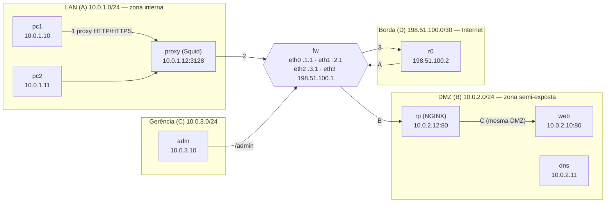

# Task — Forward Proxy (Squid) e Reverse Proxy (NGINX) no lab `labfw`

Evolução do laboratório da Task anterior: dois novos nós, `proxy` (Squid, na LAN) e `rp` (NGINX, na DMZ). Todas as evidências citadas estão em `evidencias/P*.txt` e foram geradas por `experimentos_proxy.sh`.

---

## 1. Como rodar

```bash
docker build -t kathara-proxy .        # uma vez (imagem com nginx + squid)
TERM=dumb kathara lstart               # sobe o lab
bash experimentos_proxy.sh             # roda tudo e grava evidencias/P*.txt (~2 min)
TERM=dumb kathara lclean               # derruba o lab
```

Aplicar a política do firewall à mão (no `fw`):

```bash
bash /root/fw_proxy.sh antes     # Task anterior: Internet -> web direto
bash /root/fw_proxy.sh depois    # Task atual: Internet -> rp -> web; saída só pelo Squid
bash /root/fw_proxy.sh remover   # volta ao estado do boot (FORWARD ACCEPT)
```

---

## 2. Topologia e plano de endereçamento



Fluxos:

- **Saída:** `pc1/pc2 → proxy (Squid) → fw → Internet` (passos 1 → 2 → 3).
- **Entrada:** `Internet → fw → rp (NGINX) → web` (passos A → B → C).

Os nomes `ok.lab`, `bloqueado.lab` e `restrito.lab` apontam para o `web` (10.0.2.10) via `/etc/hosts` do `proxy`; `externo.lab` aponta para o `r0` (198.51.100.2), que serve uma página simples e representa um site da Internet.

| Nó | Zona | Interface | Endereço | Função |
|---|---|---|---|---|
| pc1 | LAN | eth0 | 10.0.1.10/24 | cliente |
| pc2 | LAN | eth0 | 10.0.1.11/24 | cliente |
| **proxy** | LAN | eth0 | **10.0.1.12/24** | Squid (novo) |
| web | DMZ | eth0 | 10.0.2.10/24 | servidor web |
| dns | DMZ | eth0 | 10.0.2.11/24 | DNS |
| **rp** | DMZ | eth0 | **10.0.2.12/24** | NGINX (novo) |
| adm | Gerência | eth0 | 10.0.3.10/24 | administração |
| fw | todas | eth0–eth3 | .1.1 / .2.1 / .3.1 / 198.51.100.1 | firewall/roteador |
| r0 | Borda | eth0 | 198.51.100.2/30 | "Internet" |

### Fluxos permitidos (política `depois`)

| Origem → Destino | Porta | Decisão | Onde é aplicado |
|---|---|---|---|
| pc1/pc2 → proxy | 3128 | permitido | mesma LAN, não passa pelo fw; ACL do Squid |
| proxy → Internet | qualquer | permitido | fw (`eth0→eth3`, só origem 10.0.1.12) |
| proxy → web | 80, 443 | permitido | fw (`eth0→eth1`, só origem 10.0.1.12) |
| pc1/pc2 → web ou Internet (direto) | — | **negado** | fw (Default Deny) |
| Internet → rp | 80 | permitido | fw (`eth3→eth1`, destino 10.0.2.12) |
| Gerência → rp | 80 | permitido | fw (`eth2→eth1`) |
| Internet → web (direto) | — | **negado** | fw (política + regra DROP explícita só para contagem) |
| Internet → LAN, DMZ → LAN | — | negado | fw (Default Deny) |
| rp → web | 80 | permitido | mesma DMZ, não passa pelo fw |
| respostas | — | permitido | fw (`conntrack ESTABLISHED,RELATED`) |

---

## 3. Squid — controlando a saída

Configuração em `proxy/etc/squid/squid.conf`. `pc1` e `pc2` recebem `http_proxy` e `https_proxy` apontando para `10.0.1.12:3128` (em `/etc/profile.d/proxy.sh` e `~/.bashrc`, definidos nos `pc*.startup`). Nos experimentos o proxy é passado explicitamente com `curl -x`.

### 3.1 Forward Proxy e ACLs (`P3_squid_acl.txt`)

| Teste | Resultado |
|---|---|
| pc1 e pc2 → `ok.lab` | 200 |
| pc1 e pc2 → `bloqueado.lab` | **403** (`TCP_DENIED`) |
| pc1 → `restrito.lab` | 200 |
| pc2 → `restrito.lab` | **403** (controle por cliente) |
| pc1 → `externo.lab` (via fw, até o r0) | 200 |
| HTTPS `https://ok.lab` (CONNECT) | 200, `TCP_TUNNEL/200` no log |
| HTTPS `https://bloqueado.lab` (CONNECT) | negado, `TCP_DENIED/403 CONNECT bloqueado.lab:443` |

No HTTPS o Squid só enxerga `host:porta` do `CONNECT` (o conteúdo vai cifrado dentro do túnel). O bloqueio por domínio funciona, mas um bloqueio por caminho (`/admin`) em HTTPS exigiria interceptação TLS (*SSL bump*), que não foi configurada.

Com o firewall na política `depois`, o acesso direto de `pc1/pc2` ao web ou à Internet dá timeout (`P2_fw_depois.txt`): o Squid é o único caminho de saída.

### 3.2 Logs e cache (`P4_squid_cache.txt`)

Quatro requisições seguidas a `http://ok.lab/admin/`, mais uma forçada com `Cache-Control: no-cache`:

| # | `X-Cache` (cabeçalho) | `Age` | `access.log` do Squid | Log do web |
|---|---|---|---|---|
| 1 | HIT (revalidado) | 0 | `TCP_REFRESH_UNMODIFIED/200`, `HIER_DIRECT/10.0.2.10` | 1 requisição, respondida com `304` |
| 2 | HIT | 1 | `TCP_MEM_HIT/200`, `HIER_NONE/-` | nada |
| 3 | HIT | 2 | `TCP_MEM_HIT/200` | nada |
| 4 | HIT | 3 | `TCP_MEM_HIT/200` | nada |
| forçada | MISS | — | `TCP_MISS/200` | 1 requisição (`200`) |

> Nota: nesta execução a página já estava no cache de uma rodada anterior (o lab não foi reiniciado entre as execuções). Por isso a requisição 1 foi **revalidada** com o web (`If-Modified-Since` → `304`, código `TCP_REFRESH_UNMODIFIED`) em vez de `TCP_MISS`. Num lab recém-iniciado ela aparece como `TCP_MISS/200` e `X-Cache: MISS`. A conclusão não muda: 5 requisições do cliente, só 2 chegaram ao web.

**Como saber se veio do cache?** Três evidências independentes concordam:

1. **Cabeçalhos da resposta:** `X-Cache: HIT from proxy` e `Age` crescente.
2. **`access.log` do Squid:** código `TCP_MEM_HIT` e `HIER_NONE/-`, ou seja, nenhum servidor de origem foi contatado.
3. **Log do servidor de origem:** o web registrou só 2 requisições para 5 feitas pelo cliente.

A terceira é a mais forte, porque vem de outra máquina. O cache é compartilhado: em `P3` o `pc2` recebeu `TCP_MEM_HIT` de uma página que o `pc1` tinha buscado.

Configuração usada: o `http.server` do web não manda `Cache-Control`, então foi preciso `refresh_pattern . 5 20% 4320` para o conteúdo ficar fresco por pelo menos 5 minutos.

### 3.3 Comparação: bloqueio por IP no firewall × por domínio no Squid (`P5_ip_vs_dominio.txt`)

`ok.lab` e `bloqueado.lab` têm **o mesmo IP** (10.0.2.10).

| Política | Resultado |
|---|---|
| Squid, ACL por domínio | `ok.lab` = 200, `bloqueado.lab` = 403. Separa os dois pelo nome. |
| Firewall, `REJECT` do IP 10.0.2.10 para o Squid | `ok.lab` (URL não cacheada) = **503**, derrubado junto. O firewall não consegue permitir um nome e negar o outro. |

Duas observações do experimento:

- Com a regra do firewall ativa, uma URL **já em cache** continuou respondendo 200: o Squid serviu do cache sem abrir conexão e o firewall nem foi consultado. Um bloqueio no firewall não retira conteúdo já cacheado.
- O `bloqueado.lab` seguiu em 403 mesmo com a regra do firewall. O Squid nega antes de tentar conectar.

**Por que o Squid decide o que um firewall L3/L4 não decide?** O firewall vê IP e porta de origem e destino, e um IP pode hospedar centenas de sites (hospedagem virtual, CDN). O Squid termina a conexão HTTP e lê a requisição: nome do host (`Host` ou a URL completa), método, URL, cabeçalhos. Também sabe quem pediu (IP do cliente) e guarda a resposta no cache. É o mesmo princípio do L7 da Task anterior: mais camadas da pilha são interpretadas, então a regra pode falar a língua da aplicação.

---

## 4. NGINX — protegendo a entrada

Configuração em `rp/etc/nginx/sites-available/default`.

### 4.1 Reverse Proxy e firewall (`P1_fw_antes.txt`, `P2_fw_depois.txt`)

| Teste (a partir do `r0`, a "Internet") | Antes | Depois |
|---|---|---|
| `r0 → web` direto (10.0.2.10) | **200** | **bloqueado** (timeout) |
| `r0 → rp` (10.0.2.12) | bloqueado | **200** (conteúdo `OK-WEB` do web) |

- Contadores do `fw` no estado `depois`: a regra `DROP eth3 → 10.0.2.10` registrou pacotes. Tentativas diretas ao web foram feitas e barradas.
- No log do web, as requisições vindas da Internet aparecem com origem `10.0.2.12`: para o web, quem pede é sempre o `rp`.
- `rp → web` não passa pelo `fw`: os dois estão na mesma rede da DMZ (switch L2). A regra "Internet não alcança web" é do firewall; "só o `rp` fala com o web" vale para quem vem de fora da DMZ.

### 4.2 Controles no NGINX (`P6_nginx.txt`)

| Controle | Teste | Resultado |
|---|---|---|
| `/admin` só da rede de gerência (`allow 10.0.3.0/24; deny all`) | `r0 → /admin/` | **403** |
| | `adm → /admin/` | **200** (`OK-ADMIN`) |
| Só `GET` e `HEAD` (`limit_except`) | `POST /`, `DELETE /` | **403** |
| Rate limiting (2 req/s, burst 5) | 15 requisições seguidas do `r0` | `200 ×6`, depois `429 ×9` |
| Headers de segurança e `server_tokens off` | `curl -I` | `X-Frame-Options: DENY`, `X-Content-Type-Options: nosniff`, `Content-Security-Policy`; `Server: nginx` sem versão |
| Log para análise | `rp_access.log` | 403 (admin, POST, DELETE) e 429 registrados com IP de origem |

---

## 5. Defense in Depth (`P7_defesa_em_profundidade.txt`)

### Cenário 1 — uma regra do firewall libera HTTP externo por engano

Foi inserida a regra `iptables -I FORWARD 1 -i eth3 -o eth1 -p tcp --dport 80 -j ACCEPT` (Internet → toda a DMZ, porta 80).

| Teste | Resultado |
|---|---|
| `r0 → rp/admin/` | **403**, o NGINX continua protegendo |
| `r0 → rp` com `POST` | **403** |
| `r0 → web/admin/` direto | **200**, sem proteção |

O NGINX protege tudo que passa por ele, mesmo quando o firewall falha. Mas o erro também abriu o caminho **direto** ao web, e ele não tem proteção própria: o `/admin` ficou exposto. Moral: a segunda barreira só vale se não puder ser contornada. Um complemento barato seria o próprio `web` aceitar apenas conexões do `rp` (firewall no host ou no servidor web).

### Cenário 2 — o `web` é comprometido

Testes feitos a partir do `web` (exit 28 = bloqueado por timeout; 0 = alcançou):

| Destino | Resultado | Barreira |
|---|---|---|
| pc1 (LAN) | bloqueado | fw: DMZ → LAN negado |
| proxy/Squid (LAN) | bloqueado | fw: DMZ → LAN negado |
| adm (Gerência) | bloqueado | fw: DMZ → Gerência negado |
| Internet (r0) | bloqueado | fw: DMZ → Internet sem regra |
| **rp (mesma DMZ)** | **alcançado** | nenhuma: não passa pelo fw |

O atacante no `web` não chega à LAN, à gerência ou à Internet (não consegue baixar ferramentas nem abrir canal de saída), por causa do Default Deny e da segmentação em zonas. Ele alcança **os vizinhos da DMZ** (`rp`, `dns`), porque o tráfego dentro da mesma rede não é inspecionado pelo `fw`. Para reduzir isso, o caminho seria separar o `rp` e o `web` em sub-redes distintas ou usar microssegmentação.

---

## 6. Firewall, Forward Proxy e Reverse Proxy fazem a mesma coisa?

Não. Cada um fica em uma posição, vê informações diferentes e tem um modo de falha diferente.

| | Firewall (`fw`) | Forward Proxy (Squid) | Reverse Proxy (NGINX) |
|---|---|---|---|
| Representa | a rede (roteia e filtra) | os **clientes internos** diante dos servidores externos | os **servidores** diante dos clientes externos |
| Posição | entre todas as zonas | LAN, no caminho de saída | DMZ, no caminho de entrada |
| O que vê | IP, porta, protocolo, estado da conexão (e MAC) | HTTP: host, URL, método, cliente (em HTTPS, só `host:porta`) | HTTP: caminho, método, headers, taxa de requisições |
| Decide com base em | endereços e portas | domínio, cliente, cache | caminho, rede de origem, método, taxa |
| Se falhar | sem regras corretas, tudo passa (ou nada, com Default Deny) | clientes perdem a saída, ou o proxy deixa de aplicar ACLs | o site cai, ou fica sem as barreiras da aplicação |

Por que não substituir o firewall por um proxy:

- O proxy só trata o tráfego que é **enviado a ele** e fala o protocolo que ele entende (HTTP). O firewall é obrigatório para tudo que não é HTTP e para impor que o tráfego **precise** passar pelo proxy: sem a regra do `fw`, um cliente configurado "para não usar proxy" sairia direto. Isso foi demonstrado: com a política `depois`, `pc1` direto → timeout, só o Squid sai.
- O proxy não segmenta redes nem protege a si mesmo: se o Squid ou o NGINX forem comprometidos, é o firewall que limita o dano.
- Sem proxy, o firewall não enxerga o nível da aplicação: não distingue `ok.lab` de `bloqueado.lab`, nem `/` de `/admin`.

Os três se complementam: o firewall é a barreira de rede, o Squid controla a saída em nível de aplicação, o NGINX protege o que é publicado. A falha de um não derruba as outras duas.

---

## 7. Arquivos desta Task

| Arquivo | Mudança |
|---|---|
| `lab.conf` | `proxy` (Squid) na LAN; novo `rp` na DMZ; removidos `bridged` e porta 8080 do antigo `proxy` |
| `proxy.startup`, `rp.startup` | IPs, rotas, `/etc/hosts` de teste e `service squid/nginx start` |
| `pc1.startup`, `pc2.startup` | passam a configurar `http_proxy` e `https_proxy` |
| `r0.startup` | sobe um site simples ("Internet") |
| `proxy/etc/squid/squid.conf` | ACLs, cache, log |
| `rp/etc/nginx/sites-available/default` | movido de `proxy/`; controles de segurança |
| `web/var/www/html/admin/index.html` | página `/admin` para os testes |
| `fw/root/fw_proxy.sh` | política `antes`, `depois` e `remover` |
| `experimentos_proxy.sh` | bateria de experimentos P0–P7 |
| `evidencias/P*.txt` | saídas dos experimentos |
